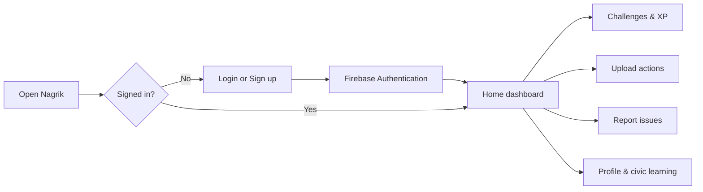
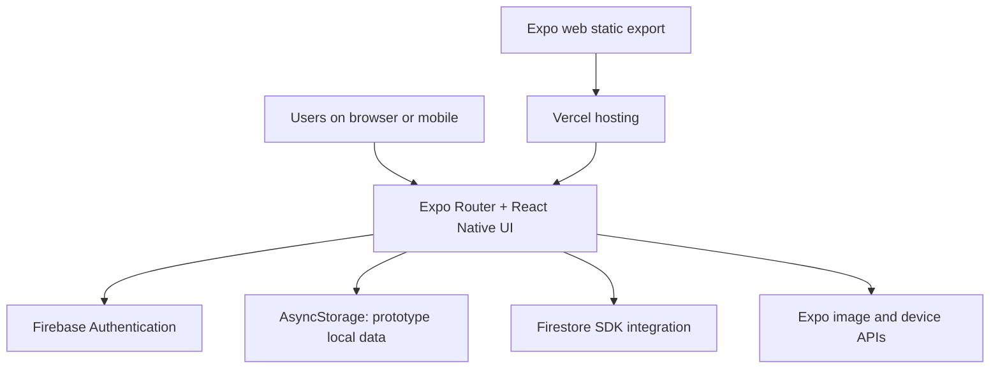

<div align="center">

# 🇮🇳 Nagrik

### A Civic Engagement & Community Impact Platform

**Report local issues · Take civic action · Complete challenges · Track participation**

[](https://nagrik-eight.vercel.app)
[](https://expo.dev/)
[](https://nagrik-eight.vercel.app)

**[🚀 Launch Web App](https://nagrik-eight.vercel.app)** · **[📖 Deployment Guide](WEB_DEPLOYMENT.md)** · **[🐛 Report an Issue](https://github.com/mathurhritik2507/Nagrik/issues)**

</div>

---

## Overview

**Nagrik** is a cross-platform civic-tech application designed to make civic participation more accessible, engaging, and measurable. It brings together civic issue reporting, community action uploads, challenges, participation rewards, and civic-learning tools in an app built with **React Native, Expo Router, and Firebase**.

Nagrik began as a mobile application and has since been adapted for the web. A **public web deployment is live on Vercel**, while the original Android/iOS-oriented source code is retained.

> **Project status:** Public **beta / portfolio demonstration**. Account registration, login, and the Home dashboard have been confirmed through the hosted web interface. Other features and cross-device data persistence still require end-to-end validation. This is not an official government service.

## Live Demo

| Destination | Link | Status |
|---|---|---|
| Web application | **[nagrik-eight.vercel.app](https://nagrik-eight.vercel.app)** | Deployed; registration/login/Home demonstrated |
| Source repository | [github.com/mathurhritik2507/Nagrik](https://github.com/mathurhritik2507/Nagrik) | Public |
| Web deployment instructions | [WEB_DEPLOYMENT.md](WEB_DEPLOYMENT.md) | Available |

**To explore:** Open the web application, create an account using the **Create account** link, sign in, and navigate the dashboard. The first visit may redirect to the login page.

## Why Nagrik?

Everyday local problems—garbage accumulation, damaged roads, water leaks, and unsafe public spaces—are easier to address when residents can document them and stay engaged. Nagrik explores how product design and participation incentives might encourage small but meaningful civic actions.

**Project goals**

- Make it easy to document community issues and civic actions.
- Encourage ongoing participation through challenges, XP, and milestones.
- Bring civic education and guidance into one accessible experience.
- Provide a foundation for future community analytics and verified impact tracking.

## Features

| Area | Experience | Current implementation notes |
|---|---|---|
| 🔐 Authentication | Register and sign in using email and password | Firebase Authentication; browser signup and login confirmed |
| 🏠 Home | Personalized welcome, XP summary, alerts, and navigation | Home dashboard confirmed on deployed web app |
| 📸 Civic Actions | Add a description and attach an image of a community activity | Implemented in the mobile-oriented UI; web camera/image handling requires testing |
| 🚧 Issue Reporting | Report civic issues with location, description, and optional photo | UI and local-save flow are present; end-to-end behavior needs verification |
| 🎯 Challenges | Explore civic challenges and participation tasks | Feature screens present; reward integrity not yet independently validated |
| 🏆 Gamification | XP, levels, streaks, rewards, and leaderboards | Prototype mechanics; not a verified real-world impact score |
| 🗺️ Impact | Civic impact and location-oriented views | Prototype UI; do not interpret demo content as live municipal data |
| 🤖 Civic Assistant | Answers common civic participation questions | **Currently keyword/rule-based**, not a connected LLM |
| 👤 Profile | Profile details and activity summary | Existing profile UI and local storage; cross-device sync not established |
| 🔔 Notifications | Reminders and engagement-related screens | Platform-specific functionality requires device/browser testing |

### Demonstrated web flow



> The flowchart represents the designed navigation. Only registration, login, and Home loading have been directly confirmed on the production web deployment so far.

## Technology Stack

| Layer | Technology |
|---|---|
| Frontend | React Native, React, TypeScript/JavaScript, Expo SDK 54 |
| Navigation | Expo Router |
| Web support | React Native Web |
| Authentication | Firebase Authentication |
| Database integration | Firebase Firestore SDK (configured; production data flows require validation) |
| Local persistence | AsyncStorage |
| Media capabilities | Expo Image Picker / camera-related APIs |
| Mobile builds | Expo Application Services (EAS) configuration |
| Web deployment | Vercel, static Expo web export |

## Architecture



**Data architecture note:** The presence of the Firestore SDK does not mean that all posts, issue reports, XP, or profiles are synchronized across users. Several existing screens read and write prototype data using AsyncStorage. Do not use the app for sensitive reports or assume public submissions reach government agencies.

## Repository Structure

```text
Nagrik/
├── app/
│   ├── (tabs)/
│   │   ├── index.tsx          # Home dashboard
│   │   ├── explore.tsx        # Civic action uploads
│   │   ├── report.tsx         # Civic issue reporting
│   │   ├── challenges.tsx     # Challenges
│   │   ├── impact.tsx         # Civic impact view
│   │   ├── assistant.tsx      # Rule-based civic assistant
│   │   ├── profile.tsx        # Profile
│   │   └── ...                # Learning, rewards, leaderboard, etc.
│   ├── login.tsx              # Login
│   ├── signup.tsx             # Registration
│   ├── onboarding.tsx
│   └── _layout.tsx
├── assets/                    # Icons and artwork
├── components/                # Shared UI components
├── constants/
├── hooks/
├── Data/
├── firebaseConfig.js          # Native Firebase configuration
├── firebaseConfig.web.js      # Browser Firebase configuration
├── app.json                   # Expo app settings
├── eas.json                   # Native EAS build profiles
├── package.json               # Scripts and dependencies
├── package-lock.json
├── vercel.json                 # Web routing/build configuration
├── WEB_DEPLOYMENT.md          # Deployment instructions
└── README.md
```

## Getting Started

### Prerequisites

- Node.js 20 or 22 and npm
- Git
- An Expo-compatible mobile device or emulator for mobile testing
- Firebase project configuration for authentication and cloud services

### 1. Clone

```bash
git clone https://github.com/mathurhritik2507/Nagrik.git
cd Nagrik
```

### 2. Install dependencies

```bash
npm ci
```

If npm reports a dependency-lock mismatch, reconcile the dependency files locally before rebuilding; do not silently bypass dependency errors.

### 3. Run in your browser

```bash
npm run web
```

### 4. Run the mobile development server

```bash
npm start
```

Use Expo Go or a compatible development build according to the native modules required by your device setup.

### 5. Build a web export

```bash
npm run export:web
```

Expo generates a static web export into `dist/`.

## Deploying to Vercel

The live website was deployed from the GitHub repository using Vercel.

| Vercel setting | Value |
|---|---|
| Repository | `mathurhritik2507/Nagrik` |
| Root Directory | `./` |
| Framework Preset | `Other` |
| Install Command | `npm ci` |
| Build Command | `npm run export:web` |
| Output Directory | `dist` |

Detailed instructions: **[WEB_DEPLOYMENT.md](WEB_DEPLOYMENT.md)**.

If authentication is used on a new deployed domain, check the Firebase Authentication provider settings and authorized domains as appropriate for your sign-in flow. Review Firestore security rules before inviting real users.

## Web + Android Compatibility

The web extension added:

1. A restored root `package.json` with Expo web scripts.
2. `firebaseConfig.web.js` for browser-compatible authentication initialization, preserving `firebaseConfig.js` for native usage.
3. `vercel.json` for web deployment configuration.
4. Inline authentication error messages on both login and signup screens, so browser users can see failures.
5. A working Vercel-hosted web preview.

**Platform caveats:** Camera, file selection, push notifications, haptics, browser refresh routing, and local persistence can behave differently across Android, iOS, and web. They should be tested on each target platform before a public release.

## Screenshots

Add actual screenshots from the deployed website here after capturing them. Suggested views: Login, Home, Civic Actions, Report Issue, Challenges, and Profile.

<!-- Example once screenshots are committed:

-->

## Validation Status

| Check | Status |
|---|---|
| Vercel build and initial page rendering | ✅ Confirmed via deployment screen |
| Email/password account creation | ✅ Confirmed on hosted web app |
| Login and authenticated Home dashboard | ✅ Confirmed on hosted web app |
| Responsive desktop design | 🟡 Needs refinement |
| Issue submissions and cross-device data sync | 🟡 Not yet verified |
| Photo uploads and device permissions | 🟡 Not yet verified |
| Challenges, XP persistence, and leaderboards | 🟡 Not yet verified |
| Production-grade AI assistant | 🔲 Future improvement |
| Automated end-to-end browser tests | 🔲 Future improvement |

## Roadmap

- [ ] Improve responsive desktop layouts and navigation.
- [ ] Verify account recovery, signup, login, logout, and session persistence.
- [ ] Test photo uploads and issue reporting in web and Android environments.
- [ ] Move appropriate civic reports and profiles to secured Firestore collections with ownership-aware security rules.
- [ ] Add moderation, spam controls, and privacy-safe handling of location/media.
- [ ] Create an opt-in, privacy-aware public civic issue dashboard with aggregate analytics.
- [ ] Add a clearly evaluated AI feature, such as issue categorization or duplicate-report detection.
- [ ] Implement accessibility checks, automated tests, and production monitoring.
- [ ] Publish verified UI screenshots and a short product walkthrough.

## Responsible Use & Limitations

- Nagrik is an **independent civic-tech prototype**, not a municipal grievance portal or an official channel to authorities.
- Current sample alerts, civic challenges, XP, and impact indicators should not be interpreted as verified community outcomes.
- The existing civic assistant responds using keyword-based rules. It is **not** powered by a deployed large language model.
- Prototype local storage is not equivalent to server-side synchronization or durable cloud backups.
- Avoid uploading personal documents, sensitive location details, or photos of uninvolved people until privacy and moderation controls are in place.

## Author

**Hritik Mathur**  
MS in Data Science · Pace University, New York  
Background in network engineering and automation; interests include applied AI, data engineering, and product development.

**[GitHub](https://github.com/mathurhritik2507)** · **[LinkedIn](https://www.linkedin.com/in/hritikmathur/)**

---

<div align="center">

**Nagrik — Small civic actions, stronger communities. 🇮🇳**

[Try the Web App](https://nagrik-eight.vercel.app) · [View Source](https://github.com/mathurhritik2507/Nagrik)

</div>
