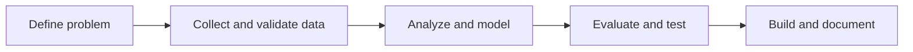

# Hi, I'm Hritik Mathur 👋

### Data Engineering | Data Science | Applied AI

**M.S. Data Science, Pace University (May 2027)** · **Former Network Engineer, Vodafone Idea**

I build data pipelines, machine learning workflows, and useful applications grounded in real engineering problems.

---

## 👨‍💻 About Me

I'm pursuing an M.S. in Data Science at Pace University in New York, graduating in **May 2027**. Before graduate school, I spent approximately three years at **Vodafone Idea Limited**, working on telecommunications operations, network performance, KPI monitoring, incident response, and technical coordination. I also have research experience from Tata AutoComp Systems.

My focus is the intersection of **Python, SQL, cloud data engineering, applied machine learning, and production-minded software development**. I'm interested in Data Scientist, Data Engineer, Applied AI/ML Engineer, Analytics Engineer, and Forward Deployed Engineer opportunities with a **Summer 2027** start.

---

## 🚀 Featured Projects

| Project | What it demonstrates | Links |
|---|---|---|
| **NetOps AI — Incident Intelligence** | Telecom KPI-based incident classification; Isolation Forest anomaly detection; synthetic telemetry, holdout evaluation, tests, and Streamlit dashboards | [Code](https://github.com/mathurhritik2507/ai-network-incident-prediction) |
| **AWS Big Data Analytics** | S3 + EMR + Hive analytics for flight delays; Python preprocessing and classification workflow | [Code](https://github.com/mathurhritik2507/aws-big-data-analytics-pipeline) |
| **Nagrik — Civic Engagement** | React Native / Expo / Firebase application with civic reporting, challenges, and browser beta | [Code](https://github.com/mathurhritik2507/Nagrik) · [Web beta](https://nagrik-eight.vercel.app/login) |
| **Swipe to Help** | Moderated assistance/startup discovery platform concept; production-source synchronization remains in progress | [Code and status](https://github.com/mathurhritik2507/swipe-to-help) |
| **Foundry AI** | Early-stage founder discovery and collaboration prototype | [Code](https://github.com/mathurhritik2507/foundry-ai) |
| **Time Series Forecasting** | Python forecasting and time-series analysis | [Code](https://github.com/mathurhritik2507/time-series-forecasting-python) |
| **Network Incident Data Analysis** | Exploratory analysis of simulated incident logs, severity, and resolution trends | [Code](https://github.com/mathurhritik2507/network-incident-data-analysis) |

**[Browse the full Data Science portfolio](https://github.com/mathurhritik2507/data-science-portfolio)**

> **NetOps GeoAI:** This is a separate geospatial network-intelligence project concept. The public **NetOps AI** repository above covers incident prediction and anomaly detection; it is **not** represented as the GeoAI application. A dedicated GeoAI repository/demo link will be added when published.

---

## 🛠️ Technical Toolkit

**Languages & analysis**  
   

**ML & analytics**  
   

**Cloud & engineering**  
   

**Languages & analytics:** Python, SQL, R, pandas, NumPy, statistical analysis, Power BI, Jupyter  
**Machine learning:** scikit-learn, classification, regression, clustering, anomaly detection, forecasting, model evaluation  
**Cloud & data:** AWS S3, EMR, Hive, Hadoop, Spark, ETL/data pipelines, MongoDB  
**Applications & engineering:** Git, GitHub Actions, Streamlit, Firebase, React Native, Expo, Next.js, Vercel

---

## 💼 Engineering Experience

**Vodafone Idea Limited — Network Engineering (~3 years)**

- Analyzed network KPIs, alarms, traffic patterns, and operational incidents to support reliability decisions.
- Supported troubleshooting and cross-functional coordination across large-scale telecommunications infrastructure.
- Worked with firewall/VPN operations, security monitoring, change management, and network performance.
- Contributed to operational improvements, including incident-resolution time reduction from approximately eight hours to under two hours.

---

## 🎓 Research & Education

- **M.S., Data Science** — Pace University, New York · Expected **May 2027**
- **B.E./B.Tech, Electronics & Communication Engineering**
- **Research publication:** [*Bibliometric analysis on hand gesture firefighter assistance robots*](https://scholarworks.sjsu.edu/libphilprac/5584/) — **700+ reported downloads**.

---

## 🔁 How I Build

**Open to 2027-start opportunities in Data Science, Data Engineering, Applied AI/ML, Analytics, and Forward Deployed Engineering.**

[LinkedIn](https://www.linkedin.com/in/hritikmathur/) · [Repositories](https://github.com/mathurhritik2507?tab=repositories)

