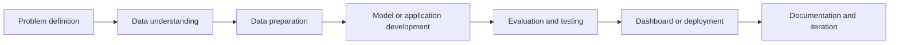

<div align="center">

# Hi, I'm Hritik Mathur 👋

### Data Engineering | Data Science | Applied AI

**MS in Data Science · Pace University, New York**  
**Former Network Automation Engineer · Vodafone Idea Limited**

Building practical machine learning systems, data pipelines, and applications that connect data to real-world decisions.

[](https://github.com/mathurhritik2507)
[](https://www.linkedin.com/in/hritikmathur/)
[](https://nagrik-eight.vercel.app)

</div>

---

## 1. About Me

I'm a Data Science graduate student at **Pace University** with a professional background in telecommunications network automation and operations at **Vodafone Idea Limited**.

My work experience introduced me to performance monitoring, network KPIs, traffic analysis, operational troubleshooting, stakeholder coordination, and data-driven decisions. Today, I apply that foundation to **machine learning, data engineering, analytics, and AI product development**.

I enjoy projects that move beyond a notebook: reproducible pipelines, interactive applications, transparent evaluation, and clear documentation.

## 2. What I'm Working On

- **Applied machine learning:** anomaly detection, predictive modeling, evaluation, and explainability.
- **Data engineering:** cloud pipelines, transformations, and analytics workflows.
- **AI-powered applications:** building tools that solve operational or user-facing problems.
- **Civic technology:** expanding Nagrik into a more accessible community participation platform.
- **Software engineering practices:** testing, version control, deployment, and documentation.

## 3. Professional Focus

| Area | Interests |
|---|---|
| Data Science | Classification, regression, anomaly detection, forecasting, model evaluation |
| Data Engineering | Data pipelines, ETL/ELT, SQL, cloud analytics, scalable processing |
| Applied AI | ML-powered workflows, intelligent applications, model integration |
| Analytics | KPI monitoring, dashboards, exploratory analysis, business insights |
| Engineering | Python development, GitHub Actions, testing, reproducibility |

## 4. Technical Toolkit

**Languages & analysis**  
   

**Machine learning & visualization**  
    

**Cloud, applications & workflow**  
     

*This toolkit reflects the technologies used across my coursework and portfolio; experience varies by tool.*

## 5. Featured Project — NetOps AI: Network Incident Intelligence

**[Repository](https://github.com/mathurhritik2507/ai-network-incident-prediction)** · Python · Scikit-learn · Streamlit · Plotly · GitHub Actions

A telecom-focused machine learning project connecting network performance analysis with incident prediction and anomaly detection.

The repository combines two complementary workflows:

1. **Supervised incident prediction:** Logistic Regression and Random Forest modeling using network KPI and security telemetry features.
2. **Unsupervised anomaly detection:** Isolation Forest over synthetic traffic, latency, packet loss, CPU, and availability metrics.

The anomaly extension adds a reproducible synthetic telemetry generator, chronological holdout evaluation, a separate Streamlit dashboard, and automated tests in GitHub Actions.

**Run the anomaly dashboard locally:**

```bash
git clone https://github.com/mathurhritik2507/ai-network-incident-prediction.git
cd ai-network-incident-prediction
pip install -r requirements.txt
python train_anomaly.py
streamlit run anomaly_dashboard.py
```

> **Evaluation note:** The extension uses synthetic data with injected incidents. Results are prototype evaluation metrics, not validated production network performance.

## 6. Featured Project — Nagrik: Civic Engagement Platform 🇮🇳

**[🚀 Live Web App](https://nagrik-eight.vercel.app)** · **[Source Code](https://github.com/mathurhritik2507/Nagrik)** · React Native · Expo · Firebase · Vercel

Nagrik is an independent civic-tech application designed to encourage community participation through issue reporting, civic action uploads, challenges, XP rewards, and a civic guidance assistant.

**Implemented areas** include:

- Email/password registration and login with Firebase Authentication.
- Authenticated Home dashboard and application navigation.
- Civic issue reporting and community action upload interfaces.
- Challenges, XP and participation-oriented screens.
- User profile, learning, notifications, and civic impact interfaces.
- Browser deployment alongside the existing React Native mobile codebase.

**Recent upgrades:** restored the Expo package manifest, introduced browser-specific Firebase authentication, improved visible login/signup error handling, added Vercel configuration, and deployed a public web preview.

**Current status:** Signup, login, and the Home dashboard were confirmed on the public website. Other features, browser-specific media handling, and cross-device synchronization still need full end-to-end validation. The civic assistant currently uses keyword-based rules, not a hosted generative AI model.

> Nagrik is a beta portfolio application, not an official municipal reporting service. Sample alerts and XP values should not be treated as verified civic outcomes.

## 7. Featured Project — AI ATS Resume Analyzer

**[Repository](https://github.com/mathurhritik2507/ai-ats-resume-analyzer)**

A portfolio project exploring AI-assisted resume analysis and job-description alignment. The goal is to make application feedback clearer and more actionable.

Visit the repository for the current implementation, supported features, and usage instructions.

## 8. Featured Project — AWS Big Data Analytics Pipeline

**[Repository](https://github.com/mathurhritik2507/aws-big-data-analytics-pipeline)**

A cloud data-engineering portfolio project focused on analytics-pipeline concepts and AWS-oriented workflows.

This project represents my interest in moving data from ingestion and transformation toward analysis and business decisions. See the repository for its exact architecture and implementation details.

## 9. Additional Data Science & Analytics Projects

| Project | Repository | Focus |
|---|---|---|
| Financial Data Forecasting | [Forecasting Financial Data in Real Time](https://github.com/mathurhritik2507/Forecasting-Financial-Data-in-Real-Time) | Financial time-series analytics |
| Time Series Forecasting | [time-series-forecasting-python](https://github.com/mathurhritik2507/time-series-forecasting-python) | Forecasting methods in Python |
| Network Incident Data Analysis | [network-incident-data-analysis](https://github.com/mathurhritik2507/network-incident-data-analysis) | Operational KPI analysis |
| Weka ML Classification | [weka-machine-learning-classification](https://github.com/mathurhritik2507/weka-machine-learning-classification) | Classification workflows |
| Public Safety | [Public-Safety-Project](https://github.com/mathurhritik2507/Public-Safety-Project) | Public-safety problem exploration |
| Data Science Portfolio | [data-science-portfolio](https://github.com/mathurhritik2507/data-science-portfolio) | Collected data science work |

*The linked repositories contain the implementation-specific documentation and current development status for each project.*

## 10. Professional Experience — Vodafone Idea Limited

**Former Network Automation Engineer | Telecommunications**

My professional experience connects operational engineering with data-driven analysis:

- Monitored network KPIs and performance indicators to understand service and operational health.
- Worked with network traffic patterns, alarm information, and incident-related data to support investigation and decisions.
- Supported traffic shifting and operational activities requiring coordination across teams and external stakeholders.
- Participated in troubleshooting, execution planning, and communication of technical activities.

This experience shapes projects such as NetOps AI: I approach ML systems by thinking about operational context, false alarms, practical usability, and how predictions would support human decision-makers.

## 11. Education

**Master of Science in Data Science**  
Pace University · New York, USA

My academic work supports interests in statistical learning, model selection, data analysis, machine learning, and practical programming.

## 12. How I Build Projects



I aim to make each portfolio project easy to explore:

- A clearly stated problem and intended user.
- Reproducible setup and training steps where relevant.
- Thoughtful evaluation rather than unsupported performance claims.
- A usable interface or tangible output where appropriate.
- Transparent limitations and next steps.

## 13. Current Learning & Development

- ML modeling and performance evaluation.
- Time-series forecasting and anomaly detection.
- Cloud-based data engineering.
- Building and deploying Python and cross-platform applications.
- Integrating trustworthy AI capabilities into useful products.
- Strengthening testing, documentation, and production-readiness.

## 14. GitHub Activity

<div align="center">


</div>

*These cards come from a third-party GitHub statistics service and may occasionally be unavailable. Language breakdown reflects public repository code, not a proficiency ranking.*

## 15. Opportunities & Collaboration

I am interested in early-career opportunities and collaboration involving:

- Data Science and applied machine learning.
- Data Engineering and analytics engineering.
- AI/ML engineering and intelligent application development.
- Customer-facing applied AI and forward-deployed engineering.
- Data products that connect technical systems with measurable business value.

I especially enjoy discussing problems where domain understanding and sound engineering matter as much as model selection.

## 16. Connect With Me

<div align="center">

### Let's build useful things with data.

[](https://github.com/mathurhritik2507)
[](https://www.linkedin.com/in/hritikmathur/)
[](https://nagrik-eight.vercel.app)

**Data Engineering · Data Science · Applied AI**

</div>
